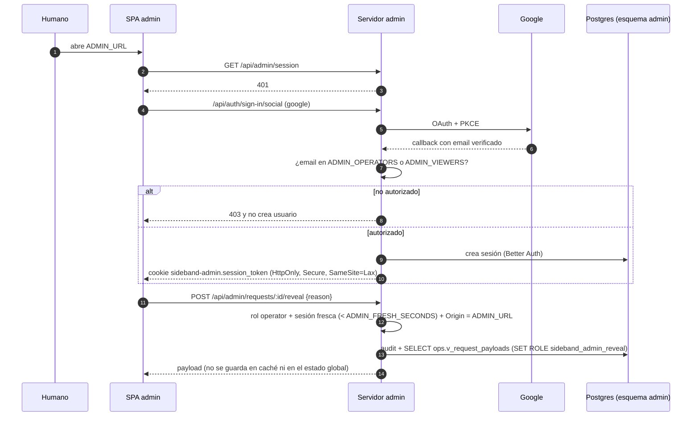
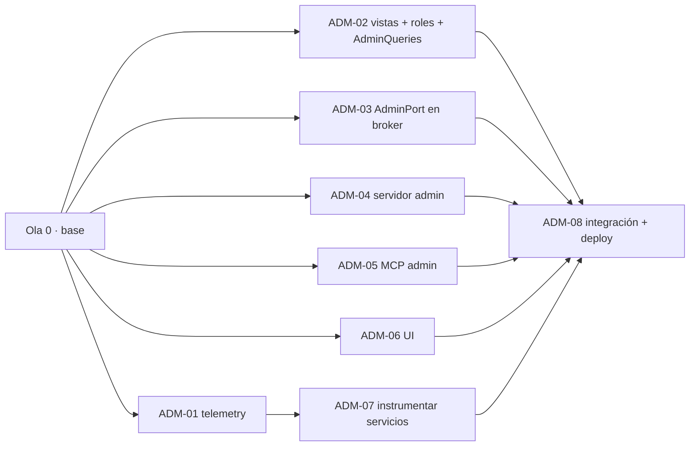

# Admin y observabilidad de Sideband

Objetivo: depurar producción viendo todo lo que pasa por debajo, desde un **panel** (humanos) y desde un **MCP de administración** (agentes), sin romper la privacidad que Sideband promete a sus usuarios.

Contrato de código (fuente de verdad, no lo cambies sin actualizar este documento):

- `apps/admin/shared/contract.ts`: tipos y tabla de rutas de la API del admin.
- `apps/admin/shared/queries.ts`: interfaz `AdminQueries` (módulo profundo de lectura).
- `apps/admin/server/mcp/index.ts` y `types.ts` en la misma carpeta definen `mountAdminMcp` y `TokenPrincipal`.
- `packages/ops/sql/0001_events.sql`: tabla `ops.events`.

## 1. Arquitectura

```mermaid
flowchart LR
  subgraph prod[Servicios Sideband]
    WEB[apps/web]
    MCP[apps/mcp]
    BRK[apps/broker<br/>HTTP + worker]
    CO[apps/server<br/>coordinación]
  end
  TEL[[@team-31/telemetry<br/>emit · span · error]]
  WEB & MCP & BRK & CO -- eventos validados por catálogo --> TEL
  TEL -- INSERT por lotes --> EV[(ops.events)]
  BRK -- tablas propias --> NX[(sideband.*)]
  WEB -- Better Auth --> AU[(public.user/session/oauth*)]
  CO --> CT[(people, memberships…)]
  subgraph views[esquema ops · vistas redactadas]
    V[ops.v_*]
  end
  EV & NX & AU & CT --> V
  subgraph admin[apps/admin]
    SPA[SPA React + shadcn]
    API[API /api/admin/*]
    AMCP[MCP /mcp]
    Q{{AdminQueries}}
  end
  SPA -- cookie de sesión --> API
  AG[Claude Code / Codex] -- Bearer sba_ --> AMCP
  API --> Q
  AMCP --> Q
  Q -- READ ONLY + SET ROLE sideband_admin_ro --> V
  API -- JWT de servicio iss=admin --> BRK
```

Decisiones (Philosophy of Software Design):

| Decisión | Por qué |
| --- | --- |
| **Lecturas por vistas `ops.v_*`**, no por las tablas | Las vistas son la interfaz pública de los datos. Las tablas siguen siendo privadas de cada módulo: si el broker cambia `sideband.requests`, actualiza la vista en el mismo PR y el admin no se entera. La redacción ocurre en la fuente (sin secretos ni texto libre). |
| **Escrituras siempre por el broker** (`AdminPort`) | El broker es dueño de la invariante «toda solicitud termina en exactamente un estado final». El admin nunca hace `UPDATE` en `sideband.*`. |
| **Un módulo de lectura, dos adaptadores** | `AdminQueries` concentra el SQL. La API HTTP y el MCP son adaptadores delgados: validan entrada, autentican, auditan y llaman a la interfaz. |
| **Telemetría con catálogo tipado** | Cada evento se declara una vez con su esquema zod. `emit()` descarta atributos no declarados, así que nadie puede filtrar un token o un texto libre por accidente. Nunca lanza: la observabilidad no tumba el request. |
| **Postgres como almacén de telemetría** | Ya existe, se consulta con SQL desde el panel y el MCP, y alcanza para el volumen de la hackatón. El catálogo es compatible con OTLP para exportar después. |

## 2. Datos

### 2.1 `ops.events` (ya creada en `packages/ops/sql/0001_events.sql`)

Una fila por evento o span. Columnas clave: `service`, `instance`, `kind`, `name`, `level`, `trace_id`, `span_id`, `parent_span_id`, `request_id`, `user_id`, `agent_id`, `duration_ms`, `status`, `error_id`, `attrs` (jsonb ≤ 8 KB, solo escalares declarados en el catálogo). Retención: `TELEMETRY_RETENTION_DAYS` (14 por defecto), la poda el servidor admin una vez por hora con `ops.prune_events(interval)`. Índices: `at`, `trace_id`, `(request_id, id)`, `(user_id, at)`, `(kind, name, at)`, `error_id`, `(service, at)` y `(name, id)` (0013, para las colas filtradas por nombre del flujo en vivo y de Eventos).

### 2.2 Vistas (ADM-02)

| Vista | Fuente | Columnas | Redacción |
| --- | --- | --- | --- |
| `ops.v_ask_receipts` | `sideband.ask_receipts` | request_id, receipt_count | El detalle de solicitud devuelve el conteo en `idempotentReceipts`. `broker.ask.receipt` registra creación, repetición y conflicto. `broker.ask.relation_checked` identifica las comprobaciones de contacto o círculo. |
| `ops.v_requests` | `sideband.requests` + `sideband.wake_jobs` | id, tool, from_address, to_address, from_user_id, to_user_id, status, outcome, rule, escalated, target_agent_id, answered_by_agent_id, allowed_fields, dropped_fields, decision_reason, internal_reason, args_keys, result_keys, has_purpose, response_signed, created_at, expires_at, closed_at, duration_ms, stuck, wake_attempts, last_wake_ok, origin_channel | Sin `args`, `result`, `purpose`, firmas ni nonce. Solo las llaves de args y result. |
| `ops.v_request_payloads` | `sideband.requests` | id, args, purpose, result | **Solo** rol `sideband_admin_reveal`. Se usa únicamente en `POST /requests/:id/reveal`. |
| `ops.v_request_events` | `sideband.request_events` | request_id, id, at, kind, status, code | `detail` se reduce a status y code. |
| `ops.v_wake_jobs` | `sideband.wake_jobs` + conexión o canal | id, request_id, attempt, state, run_at, kind, ok, http_status, code, latency_ms, user_id, agent_id, audience | Sin cuerpo de respuesta. `code` es `ok`, `retryable`, `failed` o un código `[a-z_]` del adaptador. Los avisos de origen pendientes al retirar WhatsApp quedan en estado `done` con código `channel_retired`. Cuando el estado es `running`, `run_at` indica cuándo vence la concesión. |
| `ops.v_agent_connections` | `sideband.agent_connections` | user_id, agent_id, label, wake_kind, wake_host, verified_at, last_wake_at, revoked_at, created_at | Solo el host de la URL. Nunca `wake_secret`. |
| `ops.v_users` | `sideband.users` + `sideband.sharing_rules` | user_id, address, display_name, created_at, rules | |
| `ops.v_circles` | `sideband.circles` + `sideband.circle_members` | circle_id, name, owner_user_id, created_at, members, invitations | Sin las direcciones de los miembros |
| `ops.v_identities` | Better Auth de web: `public."user"`, `public.session` (columnas camelCase) | user_id, email, name, created_at, active_sessions | Sin tokens de sesión. `user.id` es el mismo `user_id` de `sideband.users`. |
| `ops.v_oauth_clients` | `public."oauthClient"`, `"oauthAccessToken"`, `"oauthRefreshToken"` | client_id, name, user_id, redirect_hosts, created_at, last_token_at, active_tokens | Sin `client_secret` ni tokens. Token activo: sin revocar y sin vencer (access o refresh). |
| `ops.v_oauth_grants` | mismas tablas OAuth | user_id, client_id, client_name, last_token_at, active_tokens | Clientes que autorizó cada persona (los del registro dinámico no tienen dueño). Alimenta `UserDetail.identity.oauthClients`. |
| `ops.v_events` | `ops.events` | todas | Ya viene redactada. |
| `ops.v_service_health` | `ops.events` (`service.heartbeat`) | service, instance, version, last_seen_at, state (`up` < 60 s, `stale` < 5 min, `down`) | |
| `ops.v_errors` | `ops.events` kind=`error` | service, operation, type, bucket (minuto), count, first_at, last_at, sample_error_id | Para una ventana se suman los buckets. |
| `ops.v_coordination_people` | `people` + `memberships` | person_id, groups, can_ask, can_share (arreglos de grupos) | Sin `token_hash`. Crea la vista solo si existen las tablas. |

Roles (`NOLOGIN`, los crea ADM-02 de forma idempotente):

| Rol | Permisos |
| --- | --- |
| `sideband_telemetry_writer` | `INSERT` en `ops.events` y uso de su secuencia. |
| `sideband_admin_ro` | `USAGE` en `ops` y `SELECT` en todas las `ops.v_*` excepto `v_request_payloads`. Si existe la bitácora del servidor admin, también `USAGE` en `admin` y `SELECT` solo en `admin.audit` (`AdminQueries.audit`, sin leer `meta`). |
| `sideband_admin_reveal` | `SELECT` en `ops.v_request_payloads`. |

Toda lectura del admin corre en `BEGIN READ ONLY; SET LOCAL ROLE sideband_admin_ro; SET LOCAL statement_timeout = '3s'`. En dev la conexión es el superusuario local, que puede asumir el rol; en producción el usuario de `ADMIN_DATABASE_URL_RO` es miembro del rol. Las vistas usan los privilegios de su dueño, así que el rol no necesita acceso a las tablas base.

Las vistas se crean en `ops.refresh_views()` (0002), que solo crea las que tienen sus tablas de origen (`to_regclass`) y reaplica los permisos de 0003 (`ops.apply_view_grants()`). Si ops migra antes que el broker, Better Auth o la coordinación, el dueño del esquema ejecuta `SELECT ops.refresh_views();` después de crearlas (es idempotente). `ops.prune_events(interval)` (0004) exige una retención de al menos 1 hora y no tiene `EXECUTE` para los roles del admin: la ejecuta el dueño o un usuario al que ADM-08 se lo otorgue. El payload se lee solo con `createPgRevealer` (`apps/admin/server/queries/reveal.ts`, rol `sideband_admin_reveal`).

## 3. Telemetría (`@team-31/telemetry`, ADM-01)

```ts
const telemetry = createTelemetry({ service: "broker", version, sink: postgresSink(databaseUrl) })
telemetry.emit("broker.request.created", { requestId, userId, attrs: { tool, rule } })
await telemetry.span("wake.attempt", { requestId }, async (span) => { span.set({ httpStatus }) })
const errorId = telemetry.error("POST /v1/agent/ask", err, { requestId })
app.use(honoTelemetry(telemetry))          // span http.request + lee/propaga traceparent + X-Trace-Id
const fetchWithTrace = tracedFetch(telemetry) // agrega traceparent a llamadas internas
```

- Contexto con `AsyncLocalStorage`. Propagación con el encabezado W3C `traceparent` en todas las llamadas internas (web → broker, mcp → broker, admin → broker).
- Sinks: `postgresSink` (lotes de 200 o cada 500 ms, cola máxima 5000; si se llena descarta y cuenta `dropped`), `consoleSink` (JSON por línea) y `memorySink` (tests). `TELEMETRY_SINK=postgres|console|off`.
- Latido: `service.heartbeat` cada 30 s con `version` e `instance` (hostname:pid).
- `error()` devuelve un `errorId` (uuid) que el servicio expone en `X-Error-Id`. Reemplaza a `apps/broker/src/log.ts#logFailure` sin perder sus reglas (sin mensajes crudos, solo frames del repo).

### Catálogo de eventos (`packages/telemetry/src/catalog.ts`)

El resumen expone `activeQuotaWindows`: suma de las ventanas de cuota vigentes en `ops.v_quota_windows`, agrupadas por tipo de operación sin identificar titulares. En los spans `wake.attempt`, `attrs.queueWaitMs` mide desde que el intento quedó disponible hasta el envío; la duración del span mide el transporte. El worker reserva hasta ocho avisos por vuelta.

| name | kind | attrs permitidos |
| --- | --- | --- |
| `service.started` / `service.heartbeat` / `service.stopping` | lifecycle | version |
| `service.listening` | lifecycle | address, port del socket HTTP del admin o broker. El admin también indica serveSpa y devAuth. |
| `http.request` | http | method, route (patrón, nunca la ruta cruda), status, bucket |
| `http.rate_limited` | http | route, bucket |
| `auth.token.verified` / `auth.token.rejected` | auth | issuer, reason (código) |
| `auth.service_jwt.rejected` | auth | expectedIss, reason |
| `auth.oauth.consent` | auth | clientId, granted |
| `auth.scope.denied` | auth | scope, operation |
| `web.invite.progress` | lifecycle | step (`opened`, `sign_in`, `claim_address`, `address_claimed` o `connect`) |
| `web.agent.wake_configured` | lifecycle | kind (`grokbot_routine`, `openclaw_hooks` o `none`) |
| `web.agent.ping` | lifecycle | stage (`started` o `finished`), outcome, verified |
| `message.interpret`, `message.interpreted` | http, tool | duración de la interpretación y acción elegida |
| `message.recipients.resolved` | tool | ámbito y cantidad de direcciones |
| `message.turn.saved`, `message.turn.completed` | lifecycle | fase guardada y tipo de respuesta |
| `broker.profiles.searched` | tool | cantidad de perfiles públicos |
| `broker.ask.receipt`, `broker.ask.relation_checked` | lifecycle, policy | creación, repetición o conflicto del recibo y resultado de la condición relacional |
| `mcp.tool.call` | tool | tool, outcome (`ok` \| `error` \| `denied`) |
| `broker.policy.evaluated` | policy | tool, decision (`allow` \| `deny` \| `ask_owner`), rule |
| `broker.request.created` | lifecycle | tool, rule, targetAgentId |
| `broker.request.status_changed` | lifecycle | from, to, by (`agent` \| `owner` \| `broker` \| `admin`) |
| `broker.request.closed` | lifecycle | outcome, escalated |
| `broker.reply.rejected` | lifecycle | code (`nonce` \| `expired` \| `schema` \| `not_recipient` \| `closed` \| `leak_blocked`), flags (códigos `etapa:código` de sanitizeReply, solo en `leak_blocked`) |
| `broker.reply.sanitized` | lifecycle | flags, dropped (códigos `etapa:código` y campos del protocolo descartados por sanitizeReply; nunca el texto) |
| `broker.owner.decided` | lifecycle | decision |
| `broker.grant.set` / `broker.grant.revoked` | policy | grantId, category |
| `broker.contact.connected` / `broker.contact.removed` | policy | sin atributos; `requestId` y `userId` en el sobre |
| `broker.contact.tagged` | policy | tags (cantidad), by (`owner` \| `agent`), sharingApplied. Sin dirección ni nombres |
| `broker.tag.changed` | policy | action (`created` \| `updated` \| `deleted`), by, categories y followers (cantidades). Sin el nombre |
| `broker.circle.changed` | policy | circleId, action (`created` \| `deleted` \| `invited` \| `joined` \| `removed`) |
| `broker.agent.connected` | lifecycle | kind (tipo de aviso al crearse: `none`). Se emite una vez por conexión, cuando la primera llamada autenticada del agente la crea; `userId` y `agentId` en el sobre. Presencia: el agente entra a la red |
| `broker.agent.revoked` | lifecycle | by (`owner` \| `admin`). Solo la primera revocación. Presencia: el agente sale de la red |
| `broker.agent.revived` | lifecycle | kind (tipo de aviso con el que vuelve: siempre `none`). Una conexión revocada volvió a la red al presentar su agente un token válido. Presencia: el agente vuelve a entrar |
| `broker.agent.revive_denied` | lifecycle | by (siempre `admin`). Un agente presentó un token válido para una conexión que revocó el admin: sigue fuera de la red y recibe un `not_found` que no le dice quién lo cortó. La revocación del admin es terminal; la del titular no |
| `worker.tick.completed` | lifecycle | expired, wakesOk, wakesRetried, wakesFailed (solo pasadas con actividad) |
| `wake.attempt` | wake | kind, attempt, queueWaitMs, ok, httpStatus, code |
| `wake.exhausted` | wake | kind, attempts |
| `wake.lease_recovered` | wake | attempt |
| `wake.callback_verification` | wake | ok, reason |
| `coordination.tool.call` | tool | tool, outcome |
| `demo.contact.seeded` | lifecycle | action (`rules`, `address` o `wake`), userId y agentId de la identidad ficticia |
| `error` | error | operation, type, issues, frames |
| `admin.login` / `admin.logout` / `admin.reveal` / `admin.action` / `admin.token.created` / `admin.token.revoked` / `admin.mcp.call` | admin | action, target, tool |
| `admin.live.opened` / `admin.live.closed` | admin | stream (`events` \| `flow`), resumed, reset · reason (`client` \| `shutdown` \| `error` \| `stalled`), delivered; `userId` = id del admin, `durationMs` al cerrar |

Prohibido en attrs y en cualquier log: tokens, encabezados `Authorization`, nonces, secretos de aviso, `args`, `result`, texto libre (pregunta, propósito, motivo, nota, respuesta), URLs completas de aviso.

## 4. Sesiones y acceso



| Actor | Credencial | Dónde vale | Duración | Permisos |
| --- | --- | --- | --- | --- |
| Humano viewer | Cookie de Better Auth (instancia propia del admin, esquema `admin`) | `/api/admin/*` | 8 h; se renueva cada 15 min de uso; sin caché de cookie (la revocación es inmediata) | Lectura redactada |
| Humano operator | Igual | `/api/admin/*` | Igual. Acciones sensibles exigen sesión fresca (10 min) | + revelar payload, acciones en el broker, SQL, tokens |
| Agente | Token personal `sba_` + 32 bytes base64url, creado por un operator. Se guarda `sha256` | Solo `/mcp` | 1 a 30 días (7 por defecto), revocable | `admin:read` y opcional `admin:sql`. **Nunca** revela payloads ni ejecuta acciones |
| Servidor admin → broker | JWT de servicio EdDSA `iss=admin`, `aud=broker`, 60 s, `sub` = id del admin, claim `email` | `/v1/admin/*` del broker | 60 s | `rewake`, `expire`, `revokeAgent` |

Reglas:

- El rol se calcula en cada request desde `ADMIN_OPERATORS` / `ADMIN_VIEWERS`: quitar un correo revoca el acceso en el siguiente request.
- Mutaciones: `Origin` debe ser `ADMIN_URL`, el cuerpo debe ser `application/json` y todas exigen `reason` (10 a 500 caracteres) que queda en `admin.audit`.
- `ADMIN_DEV_AUTH=1` (prohibido si `NODE_ENV=production`) habilita `POST /api/admin/dev-login`, que crea una sesión de `dev@sideband.local` como operator.
- Límites: `/mcp` 60 req/min por token; reveal 10 por hora por admin; login 10 por minuto por IP.
- Tablas del servidor admin (esquema `admin`): tablas de Better Auth, `admin.tokens(id, name, token_hash unique, prefix, scopes, created_by, created_at, expires_at, last_used_at, revoked_at)` y `admin.audit(id, at, actor_type, actor_id, actor_label, action, target, reason, ip, meta)`. Cada fila de auditoría también emite su evento `admin.*`.

## 5. API HTTP

La tabla completa está en `adminRoutes` (`apps/admin/shared/contract.ts`). Resumen:

| Ruta | Rol | Qué devuelve |
| --- | --- | --- |
| `GET /api/admin/session` | viewer | Usuario, rol y si la sesión está fresca |
| `GET /api/admin/overview?window=` | viewer | Salud de servicios, solicitudes por estado, p50/p95 hasta el estado final, avisos por adaptador, errores principales y rate limits |
| `GET /api/admin/requests` · `/requests/:id` | viewer | Lista filtrable · detalle con línea de tiempo combinada (`request_events` + telemetría), avisos y trazas |
| `POST /api/admin/requests/:id/reveal` | operator + fresca | Payload real con auditoría |
| `POST /api/admin/requests/:id/rewake` · `/expire` | operator + fresca | Acción en el broker |
| `GET /api/admin/traces/:id` | viewer | Spans de todos los servicios para cascada |
| `GET /api/admin/events` · `/live` (SSE) | viewer | Historial y cola en vivo de `ops.events` (cursor por id, `Last-Event-ID`) |
| `GET /api/admin/flow/snapshot` · `/flow/live` (SSE) | viewer | Página Flujo: foto de la red (personas con dirección, conexiones activas y revocadas en 24 h, solicitudes abiertas o de los últimos 15 min) con el cursor de `ops.events` · cola filtrada por nombre en SQL con attrs recortados a la lista blanca del grafo (ver 7.1) |
| `GET /api/admin/errors` · `/errors/:id` | viewer | Errores agrupados · un error por `errorId` |
| `GET /api/admin/users` · `/users/:id` | viewer | Personas, identidad OAuth, reglas, agentes y solicitudes recientes |
| `GET /api/admin/agents` · `POST /agents/:userId/:agentId/revoke` | viewer · operator | Conexiones y salud de avisos · revocar |
| `GET /api/admin/wakes` | viewer | Cola de avisos |
| `POST /api/admin/sql` | operator | SELECT sobre `ops.v_*` |
| `GET /api/admin/audit` | viewer | Bitácora de acciones |
| `GET/POST/DELETE /api/admin/tokens` | operator | Tokens `sba_` para el MCP |

Errores: `ErrorBody` con códigos `unauthorized`, `forbidden`, `not_fresh`, `not_found`, `invalid_input`, `rate_limited`, `upstream`, `internal` (+ `errorId`).

## 6. MCP de administración

`POST /mcp` en el servidor admin. Streamable HTTP sin estado (`sessionIdGenerator: undefined`, `enableJsonResponse: true`) con `Authorization: Bearer sba_…`.

```bash
claude mcp add --transport http sideband-admin "$ADMIN_URL/mcp" --header "Authorization: Bearer sba_..."
codex mcp add sideband-admin --url "$ADMIN_URL/mcp" --bearer-token-env-var SIDEBAND_ADMIN_TOKEN
```

| Tool | Entrada | Para qué |
| --- | --- | --- |
| `admin_overview` | window | Empezar aquí: qué está roto ahora |
| `admin_services` | – | Latidos por servicio e instancia |
| `admin_search_requests` | RequestFilters | Encontrar solicitudes por estado, herramienta, dirección o atascadas |
| `admin_get_request` | request_id | Línea de tiempo completa, avisos, decisión de política, trazas |
| `admin_get_trace` | trace_id | Spans entre servicios |
| `admin_events` | EventFilters | Historial de eventos filtrado |
| `admin_errors` · `admin_get_error` | window, service, operation · error_id | Errores agrupados y detalle |
| `admin_search_users` · `admin_get_user` | q · id o dirección | Persona, OAuth, reglas, agentes |
| `admin_agents` | failing, kind | Conexiones con avisos fallando |
| `admin_wake_queue` | state | Cola de avisos |
| `admin_sql` | sql (exige `admin:sql`) | SELECT libre sobre `ops.v_*` |

Recurso `admin://schema`: vistas y columnas (desde `information_schema`) más el catálogo de eventos. Todas las tools tienen `readOnlyHint: true`, devuelven `structuredContent` más un resumen corto en texto, y cada llamada se audita (`admin.mcp.call`). Las instrucciones del servidor dicen: los datos ya vienen redactados; empieza por `admin_overview`, luego solicitud y después traza; nunca hay payloads.

## 7. UI

React 19 + Vite + Tailwind 4 + shadcn (preset Nova, Radix, Geist). Usa la skill `shadcn` (`.agents/skills/shadcn`) y el MCP `shadcn` (`.mcp.json`). Datos con TanStack Query y tablas con TanStack Table (data table de shadcn); rutas con React Router 7. Oscuro por defecto, denso y con ids en monoespaciada.

```
┌────────────┬──────────────────────────────────────────────────────────┐
│ Sideband Admin │ ⌘K  buscar request / trace / error / persona      [1h ▾] │
│            ├──────────────────────────────────────────────────────────┤
│ Resumen    │ [web ●] [mcp ●] [broker ●] [worker ◐] [coord ●]           │
│ Solicitudes│ ┌ Solicitudes ┐ ┌ p95 final ┐ ┌ Avisos ok ┐ ┌ Errores ┐   │
│ Trazas     │ │ 182  4 open │ │   9.8 s   │ │  97 %     │ │  3      │   │
│ En vivo    │ └─────────────┘ └───────────┘ └───────────┘ └─────────┘   │
│ Errores    │ ▁▂▃▅▃▂▁▂▅▇▅▃  estados por minuto (chart apilado)            │
│ Personas   │ Atascadas (2)        │ Errores principales                │
│ Agentes    │ req_8f… availability │ POST /v1/agent/reply  TypeError ×3 │
│ Avisos     │                                                           │
│ Auditoría  │                                                           │
│ Tokens MCP │                                                           │
└────────────┴──────────────────────────────────────────────────────────┘
```

| Página | Componentes shadcn |
| --- | --- |
| Resumen | sidebar, card, chart, badge, table, skeleton |
| Solicitudes (lista + detalle en sheet o página) | data table, badge por estado, tabs (Línea de tiempo · Avisos · Política · Payload), dialog «Revelar» con motivo, alert-dialog para acciones |
| Trazas | cascada propia (divs con ancho proporcional), tooltip |
| En vivo | EventSource sobre `/api/admin/live`, filtros con select y toggle-group, pausa |
| Flujo | `@team-31/agent-flow` en modo `live` sobre `/api/admin/flow/*` (ver 7.1) |
| Errores | table agrupada, sheet con frames |
| Personas / Agentes / Avisos | data table, hover-card |
| Auditoría | table |
| Tokens MCP | table, dialog de creación que muestra el token una vez con copiar |
| Global | command (⌘K), sonner, dropdown-menu de usuario, theme toggle |

Colores de estado con tokens semánticos: `answered` verde, `no_data` gris, `declined`/`denied` ámbar, `expired`/`delivery_failed` rojo, `awaiting_*` azul.

### 7.1 Flujo en vivo (`/flujo`)

Grafo de la red y de cada solicitud que cruza el broker (`packages/agent-flow`). Lo que ve un viewer es lo mismo que ya ve en Personas, Agentes, Solicitudes y Eventos: direcciones, nombres, etiquetas, códigos, ids y latencias. Nunca contenido.

**Servidor** (`apps/admin/server/live.ts`, mismo motor que `/live`):

- Filtro en SQL: `name = ANY(flowEventNames)` (índice `(name, id)`). Las `coordination.tool.call` que no son `ask_contact`/`await_contact` se descartan antes de salir (`isFlowRow`) y cada fila sale con `attrs` recortado a `flowAttrKeys` (`projectFlowRow`). Ambas listas viven en `packages/agent-flow/src/telemetry.ts`, junto al mapeo.
- Antes del primer evento de cada solicitud manda `event: request` con `FlowRequestRef` (quién pregunta y a quién): el navegador no pide `/requests/:id` por cada solicitud.
- Las vistas **Eventos** y **Flujo** comprueban sesión y rol antes de entregar cada lote. Cerrar sesión o salir de la lista de acceso cierra la transmisión con `admin.live.closed` y `reason=access_ended`. Tener la vista abierta no renueva la sesión por sí solo.
- Orden y huecos: `id` de cada mensaje = `ops.events.id`; reanuda con `Last-Event-ID` o `?after=`. Como los lotes de cada servicio confirman en cualquier orden, cada lectura relee los últimos 3 s y descarta lo ya enviado (una escritura que confirma tarde no se pierde). Si al reanudar faltan más de 50.000 ids, manda `event: reset` y sigue desde el último.
- Contrapresión: cada escritura espera al cliente; uno que no lee en 30 s se corta (`reason: stalled`). Máximo 6 streams por admin (`429`). Cada conexión deja `admin.live.opened` y `admin.live.closed`; un error inesperado, `error` con su `errorId`.

**Cliente** (`apps/admin/src/lib/flow-live.ts`): foto → stream desde su cursor → `createLiveFeed` (descarta ids repetidos y reordena por momento de ocurrencia dentro de 700 ms, así un span del MCP escrito después que los eventos del broker se dibuja en su lugar; el reloj de cada servicio solo afecta dentro de esa ventana). Si el navegador deja de reintentar, toma otra foto: con un corte menor a 60 s retoma desde el último id; si no (o con `reset`), desde el cursor nuevo y reconcilia la presencia. Refresca el directorio cada minuto y cuando aparece un usuario o agente desconocido. Guarda como mucho 4.000 pasos: al pasarse descarta los más viejos y el renderer conserva el estado (presencia incluida).

**Presencia.** En la red = agente con una conexión no revocada (un titular con dirección que nunca conectó un agente aparece en la foto inicial como agente provisional; uno cuyos agentes se revocaron, no). Entra con `broker.agent.connected` o su primera aparición en un paso; sale con `broker.agent.revoked` o cuando un refresco del directorio lo trae revocado. La inactividad nunca saca a nadie: un agente sin pasos se ve como pasivo (atenuado y sin arista).

URL: `?titulares=<dirección>,…` y `?ocultos=agent:<id>,…` guardan el filtro. El detalle de un paso enlaza a `/solicitudes/:id` y `/trazas/:id`. Pantalla completa con el botón o la tecla `f`.

## 8. Desarrollo local

| Proceso | Puerto | Comando |
| --- | --- | --- |
| SPA (Vite, proxy de `/api` y `/mcp`) | `ADMIN_PORT` (4400 + SLOT) | `pnpm dev --filter @team-31/admin` |
| Servidor admin (API, auth, MCP) | `ADMIN_API_PORT` (4450 + SLOT) | lo agrega ADM-04 al `dev` de la app |
| Producción | `ADMIN_PORT` | `node apps/admin/dist/server/server/index.js` sirve SPA, API y MCP |

Migraciones: `pnpm --filter @team-31/ops build && pnpm with-env pnpm --filter @team-31/ops migrate`.

## 9. Issues

Ola 0 (base, mergeada): contrato, scaffold de `apps/admin`, `packages/ops` con `ops.events`, puertos, MCP y skill de shadcn, y la regla de observabilidad en `AGENTS.md`.



| Issue | Dueño de archivos | Bloqueado por |
| --- | --- | --- |
| ADM-01 | `packages/telemetry/**` | – |
| ADM-02 | `packages/ops/sql/0002_*.sql` en adelante, `apps/admin/server/queries/**` | – |
| ADM-03 | `packages/broker/src/core/admin*.ts`, `packages/broker/src/ports.ts` (agrega `AdminPort`), `packages/protocol/src/http.ts` (rutas `/v1/admin/*`), `packages/auth/src/service.ts` (`iss=admin`), `apps/broker/src/http/*`, `infra/gen-keys.ts` | – |
| ADM-04 | `apps/admin/server/**` excepto `queries/` y `mcp/`; `docker-compose.yml` (servicio admin) | – (usa `createPgAdminQueries` y `mountAdminMcp`, que hoy son stubs) |
| ADM-05 | `apps/admin/server/mcp/**` | – (prueba con un `AdminQueries` falso) |
| ADM-06 | `apps/admin/src/**`, `apps/admin/components.json` | – (usa mocks tipados con el contrato si el servidor no existe) |
| ADM-07 | `apps/broker`, `apps/mcp`, `apps/web`, `apps/server`, `packages/wake` | ADM-01 |
| ADM-08 | integración, compose, deploy | todas |

Conflictos esperables: `pnpm-lock.yaml`. Al rebasar, toma la versión de `main` y vuelve a correr `pnpm install`.

### ADM-01 · `@team-31/telemetry`

- Crea `packages/telemetry` (mismo patrón de `packages/protocol`: `exports` con `types` a src y `default` a dist).
- API de la sección 3: `createTelemetry`, `emit`, `span`, `error`, `context`, `traceparent`, `flush`, `shutdown`; `honoTelemetry`, `tracedFetch`; sinks `postgresSink`, `consoleSink`, `memorySink`; catálogo `defineEvent` + `catalog.ts` con la tabla de la sección 3; latido.
- Exporta los tipos `EventName`, `EventFields<N>` y el arreglo del catálogo (el MCP admin lo publica en `admin://schema`).
- `emit` valida attrs con el esquema del evento. Si falla, guarda el evento sin attrs y emite `telemetry.invalid_event` (warn) con el nombre. Nunca lanza.
- Tests: redacción (llaves no declaradas se descartan), propagación de `traceparent` entre dos apps Hono, el sink de Postgres contra `TEST_DATABASE_URL` (aplica `applyOpsMigrations` antes), cola llena que descarta y cuenta, y que `error()` no incluya mensajes crudos.
- Hecho cuando: `pnpm --filter @team-31/telemetry test` pasa y el README del paquete muestra cómo instrumentar un servicio en 5 líneas.

### ADM-02 · Vistas, roles y `createPgAdminQueries`

- `packages/ops/sql/0002_views.sql`, `0003_roles.sql` y `0004_prune.sql` (`ops.prune_events(interval)`), idempotentes (`CREATE OR REPLACE VIEW`, roles con `DO $$ … IF NOT EXISTS`). Las vistas sobre tablas que pueden no existir (Better Auth, coordinación) se crean condicionalmente con `DO $$` + `to_regclass`.
- Implementa `apps/admin/server/queries/index.ts#createPgAdminQueries` con la interfaz `AdminQueries` completa. Cada método abre una transacción `READ ONLY`, hace `SET LOCAL ROLE sideband_admin_ro` y `statement_timeout`, y mapea filas al contrato (valida la salida con los esquemas zod).
- `sql()`: rechaza todo lo que no empiece con `SELECT`/`WITH` o tenga más de una sentencia, agrega `LIMIT 201` envolviendo la consulta, marca `truncated` y rechaza `ops.v_request_payloads`.
- `request()`: combina `ops.v_request_events` y `ops.v_events` (por request_id) en `timeline`, ordenado por `at`.
- Tests contra `TEST_DATABASE_URL`: aplica migraciones del broker (`applyPostgresMigrations`) y de ops, siembra con el store de Postgres del broker, verifica cada método, que el rol no pueda leer `sideband.requests` directo ni `v_request_payloads`, y que `sql("DELETE …")` falle.

### ADM-03 · `AdminPort` en el broker

- `AdminPort { rewake(a, requestId, reason); expire(a, requestId, reason); revokeAgent(a, userId, agentId, reason) }` con `AdminActor = { adminId, email }`. Se suma a `BrokerCore` como `admin`.
- `rewake`: solo si `awaiting_agent` y no vencida; encola un `wake_job` con el siguiente intento. `expire`: cierra como `expired` por el mismo camino del barrido. `revokeAgent`: igual que `owner.revokeAgent` pero sobre cualquier usuario. Cada una agrega `request_event` con code `admin_rewake`, `admin_expire` o `admin_revoke`.
- Rutas en `packages/protocol/src/http.ts` con `iss: "admin"`: `POST /v1/admin/requests/:id/rewake`, `POST /v1/admin/requests/:id/expire` y `POST /v1/admin/agents/:userId/:agentId/revoke`. El cuerpo es `{ reason }` y responden 204.
- `packages/auth/src/service.ts`: `ServiceIssuer` suma `"admin"` y la identidad es `AdminActor` (claims `sub` y `email`). `infra/gen-keys.ts` genera `ADMIN_SERVICE_PRIVATE_KEY` y agrega la pública a `SERVICE_JWT_PUBLIC_KEYS.admin`. Actualiza `AGENTS.md` (sección Identidad).
- Tests: en el core (memoria y Postgres con el contrato del store) y en HTTP (token `admin` válido e inválido, `mcp` o `web` rechazados en `/v1/admin/*`).

### ADM-04 · Servidor admin (Hono)

- `apps/admin/server/index.ts`: lee env con zod, crea Better Auth del admin, `createPgAdminQueries`, cliente del broker y `mountAdminMcp`; sirve `/api/auth/*`, `/api/admin/*` según `adminRoutes`, `/healthz` y en producción la SPA estática de `dist/client` (fallback a `index.html`). Escucha en `ADMIN_API_PORT` en dev y en `ADMIN_PORT` en producción (`ADMIN_SERVE_SPA=1`).
- `server/auth/`: Better Auth con Google (`ADMIN_GOOGLE_CLIENT_ID/SECRET`), pool con `search_path=admin`, `databaseHooks.user.create.before` que rechaza correos fuera de la lista, `session.expiresIn = 8h`, `updateAge = 15m`, `cookieCache` deshabilitado, `advanced.cookiePrefix = "sideband-admin"`, `trustedOrigins = [ADMIN_URL]`. Script `admin:auth:migrate`. Dev login con `ADMIN_DEV_AUTH=1`.
- `server/tokens.ts`: crear, listar, revocar y autenticar `sba_` (`authenticate` para `mountAdminMcp`), con `last_used_at` como máximo una vez por minuto.
- `server/audit.ts` y `server/broker.ts` (cliente de `/v1/admin/*` con JWT `iss=admin` y `traceparent`).
- `server/api.ts`: recorre `adminRoutes` como `apps/broker/src/http/server.ts`: valida entrada, verifica rol y frescura, `Origin` en mutaciones, rate limits, `Cache-Control: no-store` y mapea `AdminQueryError` a `ErrorBody`. SSE `/live` con poll de 1 s por `id > cursor` y heartbeat de 15 s.
- Tarea horaria: `SELECT ops.prune_events(make_interval(days => TELEMETRY_RETENTION_DAYS))`.
- Scripts: `dev` corre Vite y `tsx watch server/index.ts` en paralelo. Servicio `admin` en `docker-compose.yml` (perfil `sideband`, solo loopback).
- Tests con `AdminQueries` falso y Postgres de prueba: 401 sin sesión, 403 por rol, `not_fresh`, `Origin` inválido, token revocado o vencido, auditoría de reveal y acciones.

### ADM-05 · MCP de administración

- `mountAdminMcp(app, deps, telemetry)` recibe la instancia de telemetría del servidor. Crea un `McpServer` y un `StreamableHTTPServerTransport` sin estado por solicitud a `POST /mcp`. Responde 405 a los demás métodos.
- Tools de la sección 6 con entradas tomadas de los esquemas del contrato, `readOnlyHint: true` y `openWorldHint: false`, salida `structuredContent` más un texto breve (por ejemplo «3 solicitudes atascadas; la más vieja req_… hace 12 min»). `admin_sql` exige el scope `admin:sql`.
- Recurso `admin://schema` e `instructions` del servidor (sección 6).
- 401 con `WWW-Authenticate: Bearer` si el token falta o es inválido; 60 req/min por token; `audit()` en cada llamada.
- Tests con el cliente MCP del SDK y un `AdminQueries` falso: lista de tools, cada tool devuelve datos que pasan el esquema, sin token da 401, `admin_sql` sin scope falla.
- `apps/admin/README.md`: cómo crear un token y conectar Claude Code y Codex.

### ADM-06 · UI

- Construye la sección 7 en `apps/admin/src`. Agrega componentes con `pnpm dlx shadcn@latest add …` desde `apps/admin` (o el MCP de shadcn). No edites a mano `src/components/ui/*` salvo que la skill lo indique.
- `src/lib/api.ts`: cliente tipado que lee `adminRoutes` y valida respuestas con los esquemas. Un modo mock (`VITE_ADMIN_MOCK=1`) responde con fixtures tipadas para desarrollar sin servidor.
- Login: pantalla con «Entrar con Google» (`/api/auth/sign-in/social`) y, si el servidor responde que dev auth está activo, «Entrar como dev».
- El payload revelado vive solo en el estado local del dialog y se descarta al cerrarlo.
- Hecho cuando: `pnpm --filter @team-31/admin build` y `lint` pasan, y todas las páginas funcionan en modo mock en claro y oscuro y a 1280 px y 390 px.

### ADM-07 · Instrumentar los servicios (después de ADM-01)

- broker HTTP y worker, MCP, web (rutas de servidor y Better Auth), coordinación y adaptadores de `packages/wake`: `honoTelemetry`, eventos del catálogo en cada transición de estado y aviso, `telemetry.error` en todos los `catch` que hoy usan `logFailure` o `console.error`, y `tracedFetch` en las llamadas internas.
- Cada servicio emite latido y `service.started`.
- Prueba e2e: una solicitud por el MCP produce en `ops.events` una traza con spans de mcp y broker y el mismo `request_id`.

### ADM-08 · Integración y deploy

- Conecta los stubs reales, servicio en compose y en Railway, usuarios de Postgres con los roles de la sección 2.2, `ADMIN_URL` público en un subdominio propio (nunca el mismo origen que web), redirect de Google y una prueba de humo del panel y del MCP en producción.

## 10. Roles con Postgres administrado

En Postgres administrado el usuario de la base no es superusuario. En Postgres 16+ quien crea un rol con `CREATEROLE` recibe solo `ADMIN OPTION`, sin `SET`, así que no podría hacer `SET ROLE sideband_admin_ro`. La migración `0008_role_membership.sql` otorga al usuario de migración la membresía `WITH SET TRUE, INHERIT FALSE`. Si no se puede, el admin cae en **modo degradado**:

| Situación del usuario de la base | Resultado | Lecturas del panel y MCP | Reveal | `sql()` / `admin_sql` |
| --- | --- | --- | --- | --- |
| Superusuario (local) | Roles completos | `SET LOCAL ROLE sideband_admin_ro` | `SET LOCAL ROLE sideband_admin_reveal` | Habilitado, solo vistas |
| `CREATEROLE` (probado en PG17) | Crea los roles y se otorga `SET` | Igual | Igual | Habilitado; `sideband.*` da `permission denied` |
| Sin `CREATEROLE` | Advertencia en la migración, sin roles | `READ ONLY` sin cambio de rol, solo vistas redactadas | Funciona sin rol (la ruta exige operator, sesión fresca, motivo y auditoría) | **Deshabilitado**, porque sin el rol podría leer tablas base |

El admin detecta el modo una vez por pool con `pg_has_role(current_user, rol, 'SET')`. Los tres casos se probaron contra un Postgres 17 limpio con usuarios no superusuario.

La ficha del titular incluye `vault`: cantidades de categorías, datos, documentos y permisos en `ops.v_vault_summary`. Los eventos `broker.vault.changed`, `broker.vault.queried`, `broker.vault.document.uploaded` y `broker.vault.document.downloaded` registran cambios, consultas y transferencias sin nombres de categorías, nombres de archivo ni contenido.
`vault.memberRules` cuenta las decisiones individuales de acceso (permitir o excluir). El cambio se ve en `broker.vault.changed` con `action=set_member`; las lecturas del directorio y de los miembros se observan en `mcp.tool.call` sin devolver direcciones al admin.

La ficha también incluye `tags`: cantidades de etiquetas (y cuántas creó el titular), etiquetas puestas a contactos y permisos de la bóveda por etiqueta en `ops.v_tag_summary`. `ops.v_contact_tags` cuenta contactos y categorías por etiqueta con su ID. Ninguna vista expone nombres de etiquetas, direcciones ni datos de la bóveda. Los cambios se ven en `broker.tag.changed` y `broker.contact.tagged`, y los permisos de categoría por etiqueta en `broker.vault.changed` con `action=set_tag`.

Los turnos conversacionales se siguen con `message.turn.completed` y `message.recipients.resolved`. `AdminQueries.overview` expone `awaitingClarifications`. La vista `ops.v_message_turns` muestra identidad, fase, desenlace y vigencia de los turnos sin continuación consumida.
