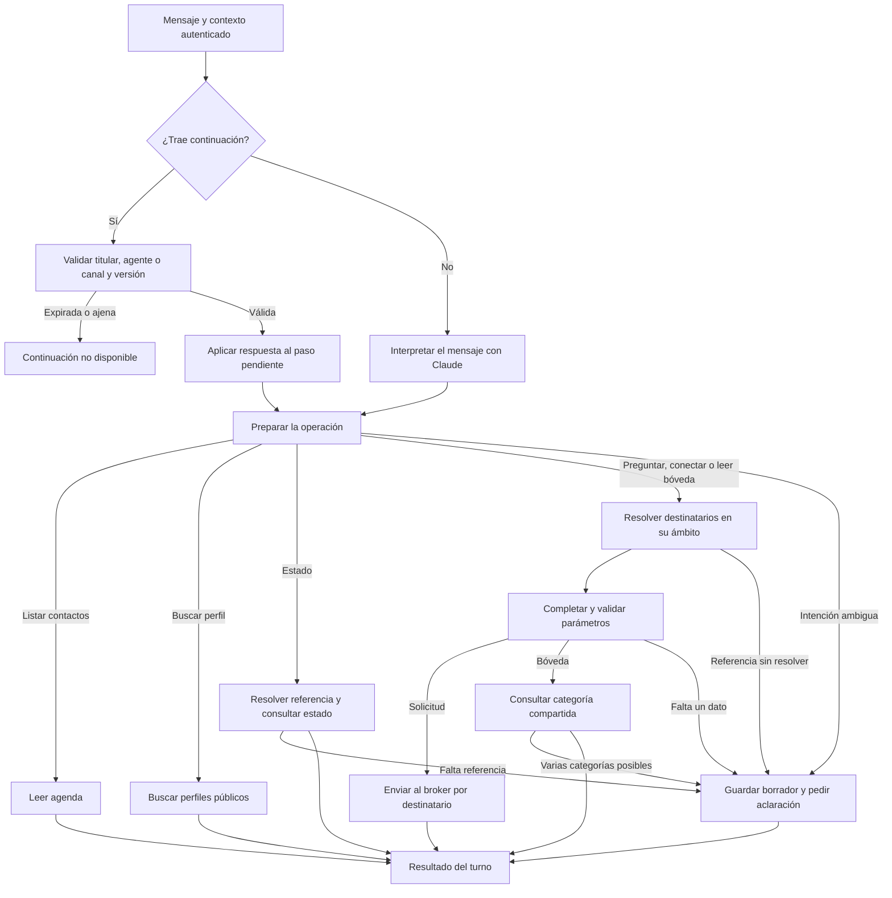
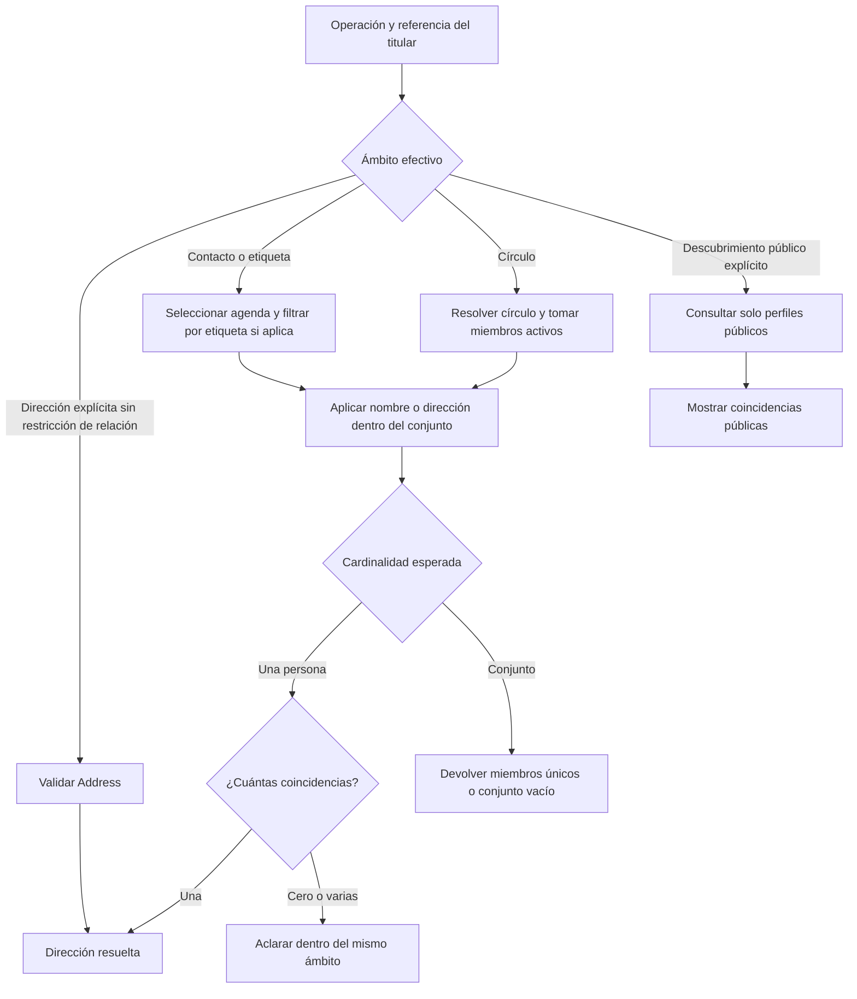

# Del mensaje del titular a una operación de Sideband

Implementación en MCP, WhatsApp y el broker. La unidad de trabajo es un turno del titular. Por ejemplo, ante «¿A mi amiga Ana le interesa la cerámica?», Sideband debe identificar a una amiga concreta, construir un `interest_check` y devolver el recibo del broker. Si hay dos Anas, la respuesta del turno es una pregunta. En ese momento se han enviado **cero solicitudes**.

## Una entrada para el canal

El MCP incorpora `sideband_message({ text, continuationId?, messageId? })`. El asistente entrega el mensaje original del titular, incluidas expresiones como «mis amigos» o «lo que tiene guardado». WhatsApp entrega el texto de un vínculo verificado a la misma función. En MCP, el cliente elige invocar esta entrada y controla el texto que transmite. El servidor conoce la identidad delegada y el texto recibido. Para dirigir los turnos en lenguaje natural a esta entrada se actualizan las instrucciones del MCP. Los clientes estructurados y el flujo entrante `inbox` → `reply` conservan sus herramientas actuales.

```ts
handleMessage(context: TurnContext, input: MessageInput): Promise<MessageReply>

type MessageInput = { text: string; continuationId?: string }
type MessageReply =
  | { kind: 'clarification'; question: string; continuationId: string; choices?: Choice[] }
  | { kind: 'requests'; items: RequesterView[]; unconfirmedCount: number; continuationId: string }
  | { kind: 'contacts'; data: AgentContacts }
  | { kind: 'profiles'; items: PublicProfile[] }
  | { kind: 'vault'; data: VaultResult }
  | { kind: 'unavailable'; reason: 'unsupported' | 'expired' | 'empty_selection' }
```

`RequesterView`, `AgentContacts` y `VaultResult` son contratos existentes. `Choice` contiene una etiqueta autorizada y una referencia local al turno. `PublicProfile` contiene `address`, `displayName` y `headline` opcional. `TurnContext` lo construye el adaptador con la identidad autenticada, las operaciones delegadas, reloj, zona horaria conocida y una referencia de entrega estable si el canal la proporciona. En MCP, el cliente adjunta la continuación al contestar una aclaración o al consultar un envío anterior. En WhatsApp, el adaptador puede recuperar la continuación activa del vínculo para el mensaje de respuesta. Un error de infraestructura usa el mecanismo de errores del canal y conserva su `errorId`. Los tipos internos de LangGraph nunca cruzan esta interfaz. [Contrato del broker](../packages/broker/src/ports.ts) · [Resultados de solicitud](../packages/protocol/src/request.ts)

## Grafo de un turno



Cada turno termina al devolver datos, recibos o una aclaración. En una respuesta `requests`, `unconfirmedCount` cuenta los envíos cuya creación aún debe reconciliarse. Cada elemento de `items` tiene un recibo confirmado, incluso si el destinatario todavía no respondió. Una solicitud pendiente continúa en el broker mediante su `requestId`. El grafo se reanuda cuando el titular responde o pregunta por el estado. Un fallo de interpretación o de lectura interrumpe el turno antes de enviar. Una operación aún no disponible devuelve `unsupported`.

## Qué módulo conoce cada decisión

| Módulo | Interfaz | Complejidad que encapsula |
| --- | --- | --- |
| Flujo de mensajes, en un paquete compartido `packages/message-flow` | `handleMessage(context, input)` | Ciclo del turno, selección de rama, borradores, reanudación, recibos y recuperación. MCP y web adaptan la entrada y presentan la salida. |
| Intérprete, interno al paquete | `interpret(text, expected?) → IntentDraft` | Prompt, modelo Claude, API de Anthropic, salida estructurada, validación y errores del proveedor. `expected` identifica qué dato falta durante una aclaración. |
| Resolución de destinatarios, interna al paquete | `resolveRecipients(selector, directory) → Resolved \| Clarify \| Empty` | Ámbito, membresía, coincidencias, cardinalidad y deduplicación. El directorio del titular aporta las relaciones visibles. La rama pública se llama directamente desde la operación de búsqueda de perfiles. |
| Protocolo y broker existentes | `AskInput`, `ToolArgs`, `AgentPort` y `OwnerPort` | Validación definitiva, identidad, scopes, grants, solicitudes, avisos y entrega firmada. El grafo invoca los clientes existentes con la identidad del canal. |

La preparación de operaciones y el almacenamiento del borrador son detalles privados del primer módulo. Una nueva categoría entra por el catálogo del protocolo. Una nueva fuente de nombres cambia el directorio. Cambiar de modelo cambia el intérprete. Ninguno de esos cambios debería exigir modificar el adaptador MCP. Las ramas se distinguen cuando cambian el trabajo o el contrato de datos. `interest_check`, `question` y `availability` comparten la misma resolución de personas y el mismo envío. [Catálogo](../packages/protocol/src/constants.ts) · [Esquemas de tools](../packages/protocol/src/tools.ts)

### LangGraph, LangChain y Claude

El flujo usa **LangGraph JS** (`@langchain/langgraph`) para expresar el estado y las transiciones condicionales, y **la integración de LangChain con Anthropic** (`ChatAnthropic`, `@langchain/anthropic`) dentro del intérprete para pedir salida estructurada a Claude por API. LangChain aporta el adaptador de modelo. LangGraph controla qué paso puede ejecutarse. El grafo se compila al iniciar el proceso. Sus dependencias se inyectan y la identidad se pasa por invocación. El proceso que llama a Claude usa `ANTHROPIC_API_KEY`, ya utilizada por WhatsApp, y una selección explícita de modelo. El intérprete se inyecta al construir el flujo, de modo que los tests del grafo pueden ejecutar cada rama localmente. [LangGraph JS](https://docs.langchain.com/oss/javascript/langgraph/overview) · [Integración Anthropic](https://docs.langchain.com/oss/javascript/integrations/chat/anthropic)

Una llamada a Claude extrae una intención discriminada (`ask`, `contacts`, `profiles`, `vault`, `status` o `clarify`), la referencia textual a personas o grupos, los cuantificadores y los parámetros mencionados. Para `ask` propone la operación (incluida `connect`) y, cuando corresponde, la categoría. Por ejemplo, de «¿A mi amiga Ana le interesa la cerámica?» se obtiene `ask`, `interest_check`, `friend`, `one`, «Ana» y «cerámica». Los datos ausentes quedan ausentes. El intérprete recibe el texto del titular y la información mínima del paso pendiente. El directorio, los resultados de terceros y las credenciales quedan en sus módulos de origen. Una respuesta como «la segunda» se resuelve contra las opciones guardadas. Solo una aclaración que requiera interpretar lenguaje libre vuelve a Claude.

El código valida el borrador con una unión Zod por intención. Usa `Category` y los tipos del protocolo como vocabulario, permite campos pendientes durante la extracción y exige la validación de `AskInput` antes del envío. Una categoría dudosa, una frase que mezcla dos intenciones o una instrucción de compartir sin destinatario inequívoco abre una aclaración concreta. Ante un fallo del proveedor o una salida inválida el canal puede reintentar el turno. [Intérprete compartido](../packages/message-flow/src/anthropic.ts) · [Validación del MCP actual](../apps/mcp/src/tools/ask.ts)

## Grafo de destinatarios



El flujo calcula el ámbito combinando la operación con las palabras del titular. «Ana» en una pregunta busca en contactos. «Mi amiga Ana» exige `tag = friend`, incluso si incluye una dirección completa. «De mi círculo de fútbol» exige pertenencia al círculo identificado. Una dirección explícita sin restricción relacional puede ir directamente a `ask` o `connect` conforme al contrato del broker. Leer la bóveda de *un contacto* exige resolverlo como contacto. Buscar un perfil se hace por petición de descubrimiento público. Si después se pide invitar a esa persona, la invitación constituye otra operación.

| Referencia | Resultado y comportamiento |
| --- | --- |
| Una persona, cero coincidencias | «No encontré a Ana entre tus amigos. ¿Qué dirección Sideband usa?» Una respuesta con dirección vuelve a comprobar el mismo ámbito. |
| Una persona, varias coincidencias | Mostrar nombres y direcciones visibles dentro de ese conjunto. Guardar las opciones del turno y aceptar una selección inequívoca. |
| Círculo sin coincidencia o con homónimos | Aclarar qué círculo quiso decir antes de obtener sus miembros. Si los nombres coinciden, ofrecer solo descriptores que el titular pueda distinguir. |
| «¿A alguien de mi círculo…?» | El conjunto nombrado es el universo de la consulta. Enviar una vez por miembro distinto, aunque llegue una coincidencia temprana. Si está vacío, informar de ello. |
| «¿A alguien le interesa…?» sin conjunto anterior | Preguntar «¿Entre tus contactos, tus amigos o algún círculo?» antes de elegir a quién consultar. |
| Persona resuelta, solicitud denegada | Devolver el `RequesterView` firmado del broker. La identidad ya quedó resuelta. |

**Datos del directorio.** MCP y WhatsApp leen la misma proyección del broker. Los contactos incluyen direcciones, etiquetas y nombre visible cuando está registrado. Los círculos aportan IDs estables y sus miembros activos. Se excluyen el titular y las invitaciones pendientes. La búsqueda pública devuelve hasta 25 direcciones y nombres visibles, con la parte local de la dirección como nombre de respaldo. El campo opcional `headline` queda reservado para cuando los titulares puedan publicarlo. [Agenda y perfil](../packages/protocol/src/owner.ts) · [Puerto compartido](../packages/broker/src/ports.ts)

### Ejemplo de dos turnos

El titular escribe «¿A mi amiga Ana le interesa la cerámica?». El directorio de ejemplo encuentra dos direcciones con etiqueta `friend`. El primer turno devuelve «¿Te refieres a ana.soto@sideband.app o a ana.vera@sideband.app?» y guarda esas dos opciones en ese orden. El titular responde «la segunda». El grafo recupera la selección, verifica que la dirección siga en el ámbito y valida el siguiente contenido con `AskInput`.

```json
{
  "to": "ana.vera@sideband.app",
  "tool": "interest_check",
  "args": { "interest": "cerámica" }
}
```

El broker devuelve el recibo. Si la decisión es `pending`, el titular puede continuar con «¿y qué dijo?» y el grafo usa el `requestId` de ese recibo. Si al primer turno hubiera llegado una sola coincidencia válida, habría preparado el mismo envío en ese turno.

## Rutas y parámetros

El verbo y el dato solicitado guían la elección. «¿Le gusta la cerámica?» admite la respuesta booleana de `interest_check`. «¿Qué talleres recomienda?» requiere la respuesta de texto de `question`, aunque comparta categoría. «Lee lo que guardó» expresa una consulta de bóveda. Si «busca lo de Ana» puede significar un perfil, un dato guardado o una solicitud anterior, el grafo pregunta cuál de esas lecturas necesita antes de consultar una fuente.

| Petición | Datos que debe resolver el grafo | Operación final |
| --- | --- | --- |
| «¿Qué contactos tengo?» | Agenda de la identidad autenticada | `sideband_contacts({})` mediante `contacts`. La respuesta ya incluye círculos. |
| «Busca el perfil público de Ana Pérez» | Consulta explícita. Ofrecer solo resultados públicos para titulares autenticados | `search_public_profiles({ query })` mediante el puerto autenticado del broker. El resultado vacío es válido. |
| «¿A Ana le interesa la cerámica?» | Dirección y un interés concreto | `ask({ to, tool: 'interest_check', args: { interest } })` |
| «¿Está libre Ana mañana a las tres por media hora?» | Fecha local, hora de inicio, duración y zona IANA. Anclar «mañana» al instante del mensaje original. Aclarar AM/PM, zona o duración cuando sean inciertos | `ask({ to, tool: 'availability', args: { date, start, durationMinutes, timezone } })` |
| «Pregúntale a Ana qué talleres de cerámica recomienda» | Dirección, pregunta y categoría `interests`. Usar `general` para una pregunta abierta que corresponda a esa categoría | `ask({ to, tool: 'question', args: { text, category } })` |
| «Invita a ana@sideband.app» | Dirección. Si el titular elige categorías, validar `share`. Conservar la diferencia entre omitir el campo y ofrecer `[]` | `ask({ to, tool: 'connect', args: { share? } })` |
| «Lee las recomendaciones que Ana guardó en su bóveda» | Contacto y catálogo compartido. Encontrar la categoría por nombre en ese catálogo, aclarar si hay varias y usar su ID real | `queryVault({ to })` y luego `queryVault({ to, categoryId })`. Un catálogo vacío termina la lectura. |
| «¿Ya respondió Ana?» | `requestId` explícito o recibo previo del mismo contexto. Si hay dos posibles, pedir elección. Sin referencia suficiente, pedir el ID | `status(requestId)` por `sideband_check`. Conservar `pending`, `allow`, `unanswered` y `deny`. |

Los nombres `sideband_*` son la superficie MCP existente. El grafo llama al puerto correspondiente una vez resuelta la intención. `sideband_ask` usa `AgentPort.ask`; los envíos de WhatsApp usan `OwnerPort.ask` con el canal `whatsapp` para conservar la entrega al teléfono. `sideband_contacts`, `sideband_vault_query` y `sideband_ask` requieren `sideband:ask`; `sideband_check`, `sideband:status`. La entrada conversacional comprueba el scope de la rama elegida y el broker verifica con la identidad original. Un usuario con solo `sideband:status` puede consultar un ID sin leer la agenda. El agente y el titular consultan la bóveda ajena mediante la misma lectura autorizada del broker. [Tools de bóveda](../apps/mcp/src/tools/vault.ts) · [Adaptador de WhatsApp](../apps/web/src/lib/whatsapp/commands.ts)

## Reanudación y envío fiable

El flujo guarda los borradores privados en `sideband.message_turns` durante 24 horas. Cada continuación está ligada al usuario, el agente o vínculo y, en MCP, sus scopes. Una sesión PostgreSQL serializa el procesamiento de esa identidad y una restricción única permite un solo turno hijo por continuación. Cada lote guarda sus trabajos antes del primer envío y registra sus recibos. Al reiniciar el proceso, otra réplica puede retomar ese estado. El almacenamiento descarta los borradores vencidos por lotes. [Almacenamiento de turnos](../packages/message-flow/src/postgres.ts)

El grafo conserva la selección ofrecida. En el envío, el broker verifica en una transacción la relación exigida, la política y el recibo de idempotencia. Si cambió la etiqueta o el usuario dejó el círculo, se omite ese destinatario. La entrega de resultados también pasa por `stillAuthorized`. En caso de reintento del lote, cada clave está ligada al origen y al destinatario. El broker devuelve el recibo original o un conflicto si cambiaron los argumentos. Para deduplicar la primera entrega, WhatsApp usa el ID del proveedor y los clientes MCP pueden enviar un UUID como `messageId`. [Contrato de envío](../packages/protocol/src/request.ts) · [Recibos del broker](../packages/broker/src/core/ask-receipt.ts)

## Observabilidad y pruebas de aceptación

En el admin, `message.interpreted` identifica la intención, `message.recipients.resolved` cuenta los destinatarios y `message.turn.completed` distingue el tipo de respuesta. `message.interpret` mide la llamada al modelo. La vista `ops.v_message_turns` muestra identidad, fase, desenlace y fechas. Los textos, las opciones y el token de continuación quedan en el almacenamiento privado. El broker emite `broker.ask.receipt` por `requestId`. [Contrato de observabilidad](./admin.md)

| Prueba | Resultado observable |
| --- | --- |
| Ana existe como contacto de trabajo y como perfil público; el titular dice «mi amiga Ana» | Aclaración de nombre en amigos, cero consultas públicas, cero envíos. |
| Dos amigas coinciden; el titular responde «la segunda» después de un reinicio | Una solicitud a la dirección elegida. La repetición concurrente de la respuesta devuelve el recibo o indica que el turno ya avanzó. |
| El titular dice «mañana» antes de medianoche y entrega la duración al día siguiente | La fecha se calcula respecto del primer turno. Se valida el `AskInput` completo antes del envío. |
| Tres miembros de un círculo; una respuesta positiva, una denegación y una pendiente | Un recibo por miembro. Solo la positiva confirma interés. Un reintento tras perder una respuesta HTTP conserva los `requestId`. |
| Selección de persona seguida de una baja de amistad antes del envío | El broker comprueba la condición relacional en la creación. Ningún aviso llega a esa dirección. |
| Otra identidad presenta la continuación o un usuario carece del scope necesario | La primera recibe continuación no disponible; la segunda recibe el error de autorización vigente. Cero efectos. |
| «¿Ya respondió?» con dos solicitudes recientes; bóveda con dos categorías del mismo nombre | Cada rama pide elegir dentro de sus referencias autorizadas. La respuesta reanuda la lectura correspondiente. |
| Claude devuelve un resultado inválido o el perfil público aún está deshabilitado | El primer caso queda como error recuperable del proveedor. El segundo informa que la búsqueda no está disponible. Cero envíos en ambos. |

Las pruebas del grafo inyectan intérprete, reloj, directorio y broker controlados. Las de integración verifican las transacciones, los scopes, la proyección de relaciones y los contratos reales del MCP y del broker. La prueba integrada utiliza el adaptador de Anthropic real con respuestas HTTP de prueba. La evaluación de interpretación contra el modelo alojado requiere una API key.

## Activación y verificación

1. Instalar con Node 24 y pnpm 10 (`pnpm install --frozen-lockfile`). Aplicar `pnpm sideband:broker:migrate` al preparar el worktree. En un despliegue con credenciales de migración ejecutar `node apps/broker/scripts/migrate.mjs` con el rol de migración y las dependencias compiladas. Si el broker usa un rol de ejecución separado, el migrador debe otorgarle `SELECT, INSERT` sobre `sideband.ask_receipts` (o usar `applyPostgresMigrations({ databaseUrl, runtimeRole })`). Se necesitan las tablas de recibos y turnos y las vistas de ops antes de activar los nuevos binarios.
2. Publicar primero el broker actualizado. Los clientes encapsulan los envíos con condición relacional o idempotencia. Un broker anterior rechaza ese cuerpo antes de crear la solicitud. Verificar su versión y las migraciones antes de habilitar el grafo en los canales.
3. Configurar `ANTHROPIC_API_KEY` en el proceso de cada canal que deba interpretar texto. El proceso usa `MESSAGE_FLOW_MODEL` o el modelo predeterminado `claude-haiku-4-5`. `MESSAGE_FLOW_DATABASE_URL` apunta a la misma base donde se aplicaron las migraciones y admite un login dedicado con `USAGE` en el esquema `sideband` y `SELECT, INSERT, UPDATE, DELETE` solo en `sideband.message_turns`. En su ausencia se usa `DATABASE_URL`.
4. En el worktree con PostgreSQL, ejecutar `pnpm check:affected`. Para repetir el recorrido MCP → Claude simulado → broker → PostgreSQL, ejecutar `pnpm with-env pnpm --filter @team-31/e2e exec vitest run src/trace.test.ts`. Con una cuenta de prueba y el proveedor configurado, comprobar «¿A mi amiga Ana le interesa la cerámica?», responder a la aclaración y verificar el recibo y la traza en el admin.
5. Para retirar la entrada conversacional del canal, quitar su clave y reiniciar ese proceso, o restaurar la versión anterior del canal. Los comandos explícitos de WhatsApp y las tools MCP estructuradas siguen disponibles. Los cambios de esquema son aditivos y las solicitudes ya aceptadas continúan en el broker.
